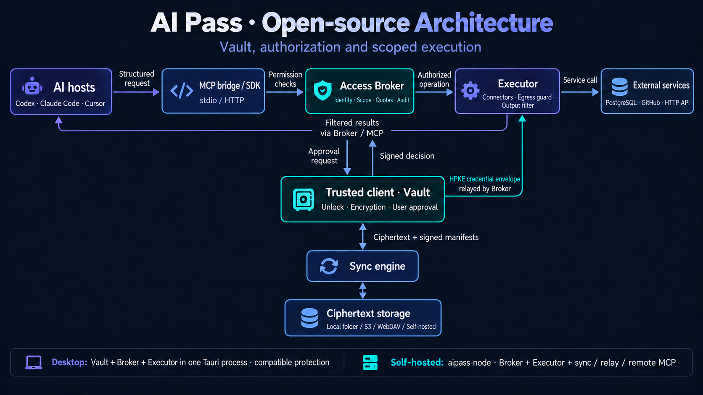
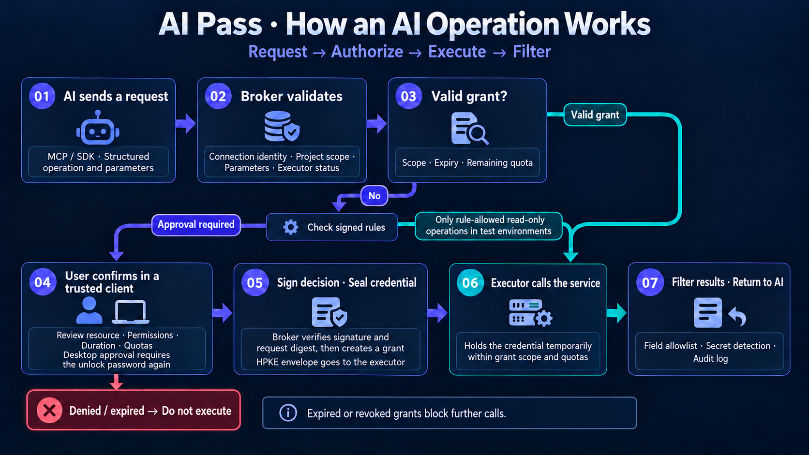
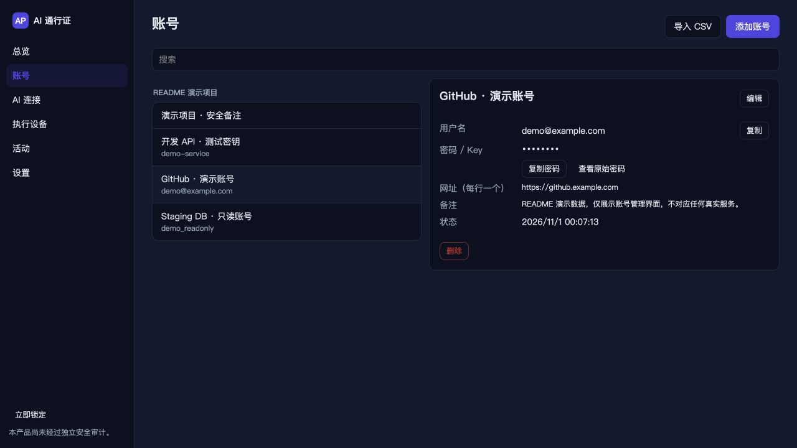
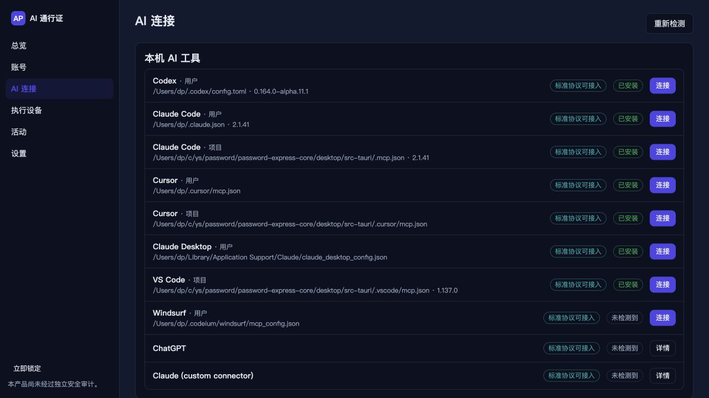
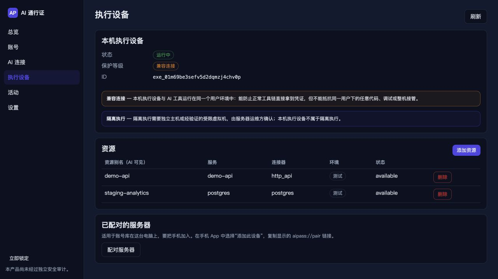
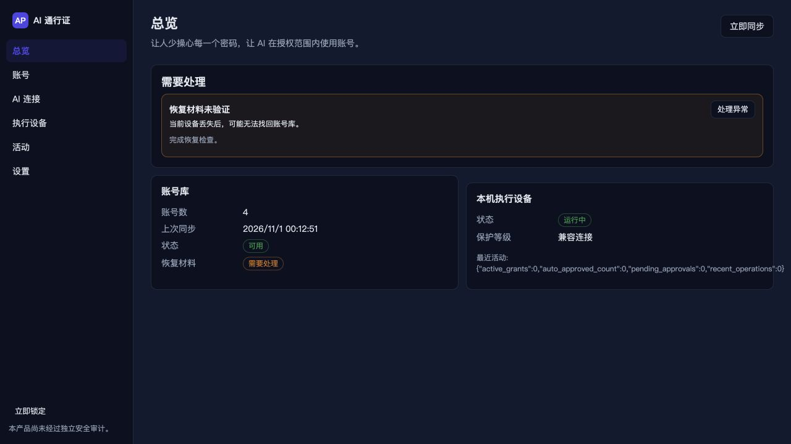

<!-- SPDX-License-Identifier: Apache-2.0 -->
# AI Pass — Open-source core

[简体中文](README.md) | **English**

> Spend less time managing passwords. Let AI use accounts within the access you approve.

AI Pass manages passwords, API keys, and database credentials. AI agents use accounts and
services through an access broker; tool output contains no raw credentials.

The open-source scope includes the cryptography and storage core, access broker, executor and
connectors, MCP bridge, SDKs, reference CLI, basic self-hosted services, and the cross-platform
desktop app (`desktop/`). The commercial mobile apps, browser extension, official cloud
services and console, team features, and officially maintained integrations are outside this
repository. The core and desktop app are licensed under Apache-2.0.

The project is under development. Data formats and interfaces may change before 1.0.
See [SECURITY.md](SECURITY.md) for security information.

## Architecture

AI hosts send structured requests through the MCP bridge or an SDK. The access broker
checks identity, resource scope, and usage limits; the executor uses connectors to call
PostgreSQL, GitHub, or a configured HTTP API. The trusted client handles vault unlocking,
approvals, and credential sealing. The sync engine reads and writes ciphertext and signed
manifests through the selected storage backend.



The desktop app embeds the vault, broker, and executor in one Tauri process. Its local
executor has the **compatible** protection level: it shares the user's environment and
does not provide operating-system isolation from other code running as that user.
Alternatively, `aipass-node` provides the broker, executor, ciphertext sync, relay, and
remote MCP as a self-hosted node, with approvals handled by paired trusted clients.

## How it works



1. **Check the request.** The broker validates the connection identity, project and resource
   scope, operation parameters, and executor status.
2. **Determine authorization.** An existing grant can be reused within its scope, expiry,
   and remaining budget. Signed rules can automatically approve only the test-environment,
   read-only operations they allow. Other requests require approval.
3. **Approve on a trusted client.** The user reviews the resource, permissions, duration,
   and limits. A desktop decision requires fresh verification of the unlock password. The
   client signs the decision and seals the credential; the broker verifies the signature
   and request digest before creating a grant. Denied or expired requests do not execute.
4. **Execute and return the result.** The executor calls the service within the grant's
   scope, filters results with field allowlists and secret detection, and records an audit
   log. Expired or revoked grants block further calls.

See the [executor documentation](crates/aipass-executor/README.md) for session termination
and upstream revocation support.

## Desktop app

Available for macOS, Windows, and Linux. Screenshots use demo accounts and resources.

### Vault

Group logins, API keys, database credentials, and secure notes by project.



### AI connections

Detect local AI tools and configure access for a user or project.



### Executors

View executor status, protection levels, and registered service resources.



### Overview

Review vault, sync, and local executor status, plus reminders that need attention.



## What's included

| Directory | Contents |
| --- | --- |
| `crates/` | Rust workspace with 14 crates, listed below |
| `sdk/typescript/`, `sdk/python/` | TypeScript SDK `@aipass/sdk` and Python SDK `aipass-sdk` |
| `deploy/` | Docker, systemd, and self-hosting examples |
| `desktop/` | Tauri 2 + React app with an embedded broker, executor, AI setup wizard, and browser native-messaging host. See the [desktop documentation](desktop/README.md) for build instructions. |
| `test-vectors/` | Cross-language vectors for request signatures, JCS, approval digests, HPKE, and XChaCha20-Poly1305 |

### Crates

| Crate | Responsibility |
| --- | --- |
| `aipass-types` | Shared models, prefixed ULIDs, error codes, canonical JSON (RFC 8785), request signatures, approval digests, and the `ExecutorBackend` trait |
| `aipass-crypto` | XChaCha20-Poly1305, HPKE (RFC 9180), Ed25519 / X25519 device identities, HKDF, Argon2id, the OS CSPRNG, and secret types that zeroize on drop |
| `aipass-vault` | Vault core: key hierarchy, entries, members, manifests, recovery, password generation, TOTP, import/export, and pairing cryptography |
| `aipass-storage` | `ObjectStore` trait; memory, local directory, S3, HTTP sync, and WebDAV backends; storage capability tests |
| `aipass-sync` | Client sync engine: manifests, checkpoints, rollback detection, tombstones, conflicts, and the offline queue |
| `aipass-sync-server` | HTTP sync API and end-to-end relay mailboxes, exposed as an embeddable axum router |
| `aipass-broker` | Access broker: connections, policies, grants, approvals, operation state machine, budgets, revocation, audit, and HTTP API |
| `aipass-executor` | Executor and connectors (`postgres`, `github`, `http_api`), outbound request protection, and output filtering |
| `aipass-client` | Signed Rust client for the broker API over Unix domain sockets or TCP |
| `aipass-mcp` | MCP bridge over stdio and Streamable HTTP; `aipass-mcp` binary |
| `aipass-hostconfig` | AI-host configuration wizard for Codex, Claude Code, Cursor, and others using standard protocols |
| `aipass-node` | Self-hosted node; `aipass-node` binary combining the broker, executor, sync, relay, and remote MCP |
| `aipass-cli` | Reference CLI and trusted client; `aipass` binary |
| `aipass-ffi` | UniFFI bindings for iOS and Android: Swift module `AIPassCore` and Kotlin package `com.aipass.core` |

Cross-component interface contracts are defined in [`docs/spec/CONTRACTS.md`](docs/spec/CONTRACTS.md).

## Security design

- Use established cryptographic libraries and algorithms. All randomness comes from the
  operating system's CSPRNG.
- Raw passwords, API keys, refresh tokens, and private keys stay out of AI tool output,
  logs, error messages, debug output, and telemetry. Secret types display `[REDACTED]`
  through `Debug` and zeroize on drop.
- IDs are identifiers, not authorization credentials. Every request verifies the
  caller's identity and permissions again.
- Approvals are bound to canonical request digests. An approval timeout fails closed;
  it never automatically approves the request.
- Storage services hold ciphertext and signed manifests. ETags provide concurrency
  control and do not replace signatures or integrity checks.

## Quick start

Run the complete end-to-end demonstration with a temporary PostgreSQL instance, a self-hosted
node, the CLI as a trusted device, and the MCP bridge:

```bash
# Run from this repository's root. Requires Homebrew PostgreSQL 17 binaries.
tests/e2e/run.sh
```

Manual steps are outlined below. See [`deploy/README.md`](deploy/README.md) for setup details,
resource configuration, and deployment limitations. Replace sample IDs and pairing links
with the values produced by your own setup.

```bash
cargo build -p aipass-node -p aipass-cli -p aipass-mcp
export PATH="$PWD/target/debug:$PATH"
aipass-node -c node.toml init --name my-node --data-dir ./node-data
aipass-node -c node.toml run &                      # broker + executor + sync + relay + /mcp
aipass vault init --device-name laptop             # vault on the trusted device
aipass item add --kind database --title "Lure DB" --username lure_readonly --secret-prompt \
    --db-host 127.0.0.1 --db-port 5432 --db-name lure --db-sslmode require
aipass-node -c node.toml pair                       # display the pairing link
aipass device pair --uri 'aipass://pair?…'          # compare the 6-digit code
aipass resource add --alias lure-db --connector postgres --project lure-store \
    --entry ent_… --config lure-db.json             # send only the entry reference
aipass-mcp pair --host codex --name my-agent --broker http://127.0.0.1:7878 --configure
aipass connections list && aipass connections approve conn_…
aipass approvals list && aipass approvals approve apr_…
aipass grants revoke grt_… --level end_sessions
```

## Build and test

Requires Rust with edition 2024 support. This repository is developed and tested with
Rust nightly 1.97 (`nightly-2026-04-29`). The desktop frontend requires Node 24 and pnpm;
see [`desktop/README.md`](desktop/README.md#build--test--run) for Tauri 2 platform prerequisites
and instructions for running or packaging the app.

```bash
# Run from this repository's root.
cargo check --workspace
cargo test -p aipass-crypto -p aipass-types -p aipass-storage
# Regenerate test vectors; overwrites the test-generated files in test-vectors/.
AIPASS_REGEN_VECTORS=1 cargo test -p aipass-crypto -p aipass-types

# Desktop app: Node 24 + pnpm.
cd desktop && pnpm install && pnpm build && pnpm test
cd src-tauri && cargo test --workspace
```

TLS uses rustls with the **aws-lc-rs** cryptographic provider throughout the workspace.
Do not enable the `ring` provider in any crate: compiling both providers makes
`rustls::ClientConfig::builder()` panic at runtime.

## Dependencies

`[workspace.dependencies]` uses mutually compatible versions current as of October 2026,
including the newer RustCrypto / dalek generation: `sha2 0.11`, `hmac 0.13`, `hkdf 0.13`,
`chacha20poly1305 0.11`, `ed25519-dalek 3`, `x25519-dalek 3`, `hpke 0.15`, `argon2 0.6`,
`rand 0.10`, `rand_core 0.10`, and `getrandom 0.4`.

Other workspace dependencies include `tokio 1.54`, `axum 0.8.9`, `tower-http 0.7`,
`reqwest 0.13` (rustls, no OpenSSL), `rusqlite 0.39` (bundled), `tokio-postgres 0.7.18`,
`sqlx 0.9`, and `uniffi 0.32`. Prefer `dep.workspace = true` when adding dependencies.

### Version constraints

- `sqlx` enables `tls-rustls-aws-lc-rs` instead of `tls-rustls`, which selects the `ring`
  provider in sqlx 0.9. This keeps the workspace on one rustls cryptographic provider
  with equivalent functionality.
- `rusqlite` is pinned to 0.39 rather than 0.41. Version 0.39 depends on
  `libsqlite3-sys 0.37`, the version line that can coexist with `sqlx 0.9`, which requires
  `libsqlite3-sys < 0.38`. The `links = "sqlite3"` constraint permits only one copy.
- Additional crate-specific notes are documented in each crate's `README.md`.

## License

Apache License 2.0; see [LICENSE](LICENSE) and [NOTICE](NOTICE). Commercial use is allowed.
The license does not grant trademark rights.

Report security issues privately as described in [`SECURITY.md`](SECURITY.md).
See [`CONTRIBUTING.md`](CONTRIBUTING.md) for contribution guidelines and DCO sign-off.
