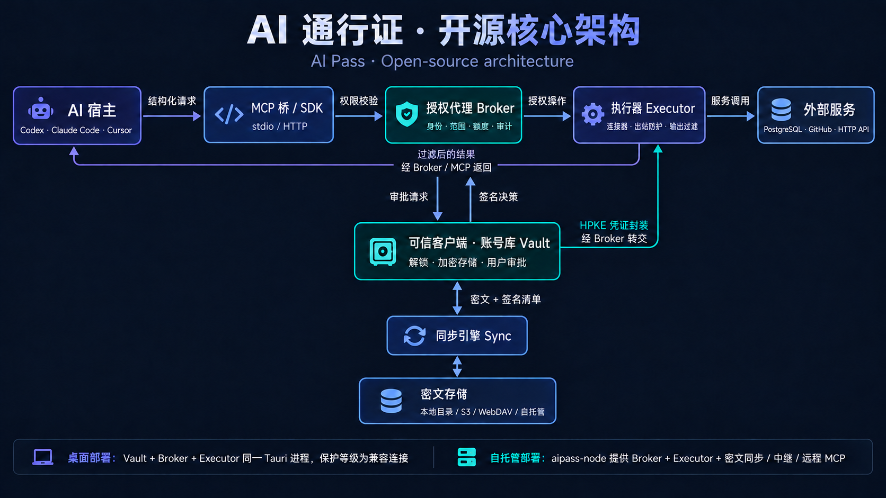
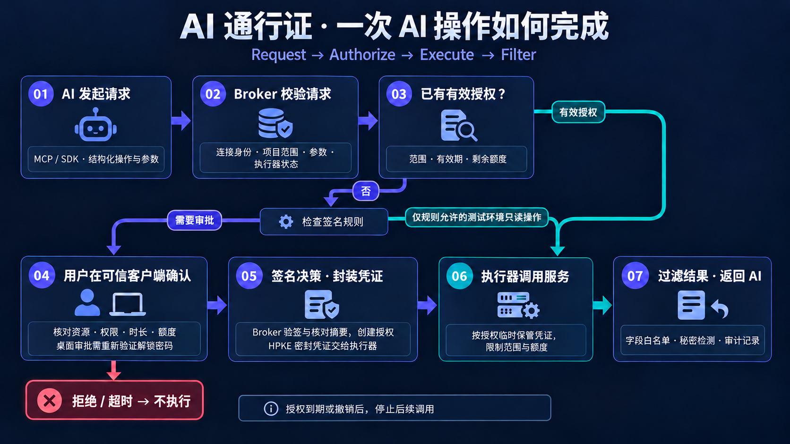
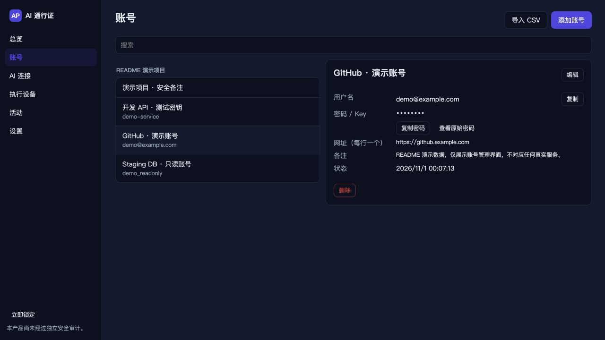
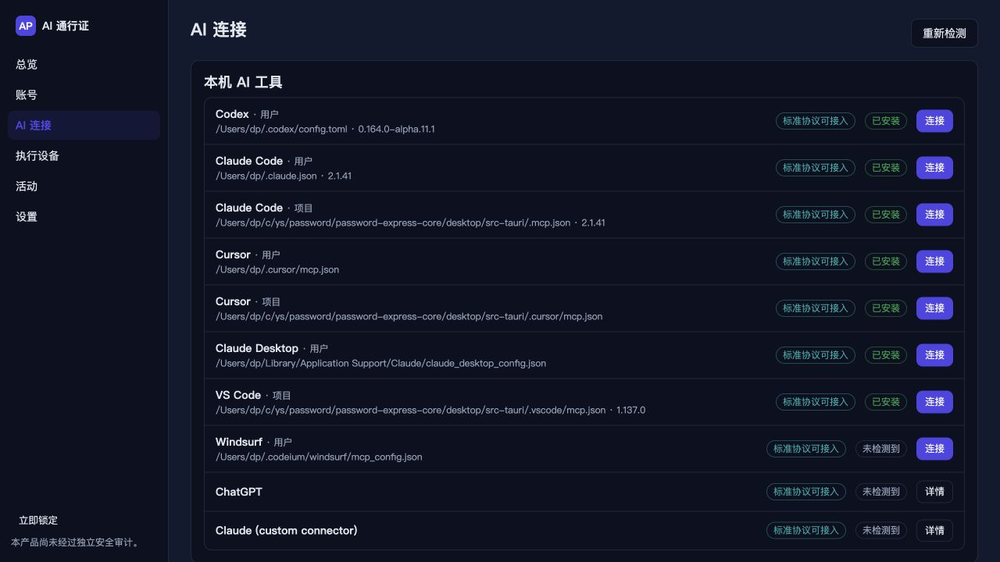
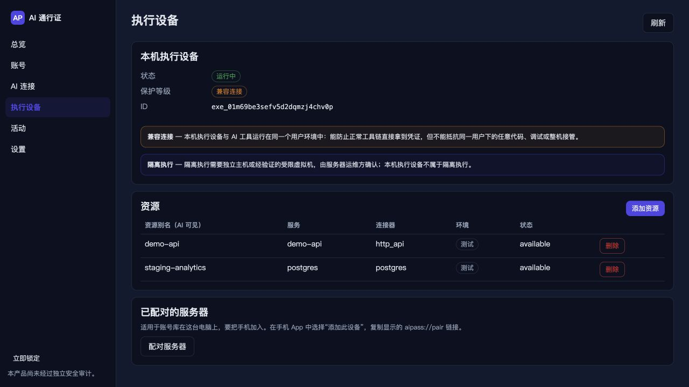
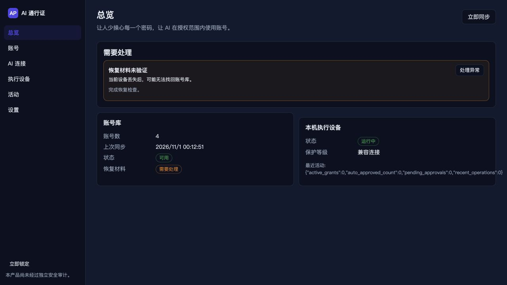

<!-- SPDX-License-Identifier: Apache-2.0 -->
# AI 通行证（AI Pass）开源核心

**简体中文** | [English](README.en.md)

> 让人少操心每一个密码，让 AI 在授权范围内使用账号。

AI 通行证管理密码、API Key 和数据库凭据。AI 通过授权代理调用账号和服务，工具输出不包含原始凭据。

本仓库以 Apache-2.0 许可提供加密与存储核心、授权代理、执行器、连接器、MCP 桥、SDK、CLI、
自托管服务和跨平台桌面 App。手机 App、浏览器扩展、官方云服务与控制台、团队功能和官方维护的集成另行提供。

项目仍在开发中，1.0 之前的数据格式和接口可能调整。安全信息见 [SECURITY.md](SECURITY.md)。

## 软件架构

AI 宿主通过 MCP 桥或 SDK 发送结构化请求；授权代理（Broker）校验身份、资源范围与额度，
由执行器（Executor）通过连接器调用 PostgreSQL、GitHub 或已配置的 HTTP API。
可信客户端负责账号库解锁、审批与凭证封装，同步引擎向存储后端读写密文与签名清单。



桌面 App 将 Vault、Broker 与 Executor 放在同一 Tauri 进程内。本机执行器采用**兼容连接**，与当前用户共享运行环境。
也可部署 `aipass-node`，提供 Broker、Executor、密文同步、中继与远程 MCP，由配对的可信客户端审批。

## 工作原理



1. **请求校验**：Broker 校验连接身份、项目和资源范围、操作参数及执行器状态。
2. **授权判定**：已有有效授权可在范围、有效期和剩余额度内复用；签名规则仅能自动批准其允许的测试环境只读操作，其余请求进入审批。
3. **可信审批**：用户核对资源、权限、时长与额度；桌面审批需重新验证解锁密码。客户端签名决策并封装凭证，Broker 验签、核对请求摘要并创建授权。拒绝或超时均不执行。
4. **执行与返回**：执行器按授权调用服务，结果经过字段过滤和秘密检测后返回，并记录审计。授权到期或撤销后，停止后续调用。

会话终止与上游撤销的支持范围见[执行器文档](crates/aipass-executor/README.md)。

## 桌面 App

支持 macOS、Windows 和 Linux。截图中的账号与资源为演示数据。

### 账号库

按项目管理登录账号、API Key、数据库凭据和安全备注。



### AI 连接

检测本机 AI 工具，配置用户或项目的接入方式。



### 执行设备

查看执行设备状态、保护等级和已登记的服务资源。



### 总览

汇总账号库、同步、本机执行设备状态和需要处理的提醒。



## 包含什么

| 目录 | 内容 |
| --- | --- |
| `crates/` | Rust 工作区（14 个 crate，见下表） |
| `sdk/typescript/`, `sdk/python/` | TypeScript SDK `@aipass/sdk` 与 Python SDK `aipass-sdk` |
| `deploy/` | Docker、systemd 配置与自托管示例 |
| `desktop/` | Tauri 2 + React 桌面 App，内置授权代理、执行器、AI 接入向导和浏览器原生通信程序。构建方式见 [桌面端文档](desktop/README.md) |
| `test-vectors/` | 跨语言测试向量：请求签名、JCS、审批摘要、HPKE、XChaCha20-Poly1305 |

### Crate 一览

| crate | 职责 |
| --- | --- |
| `aipass-types` | 共享模型、带前缀的 ULID、错误码、规范化 JSON（RFC 8785）、请求签名、审批摘要、`ExecutorBackend` trait |
| `aipass-crypto` | XChaCha20-Poly1305、HPKE（RFC 9180）、Ed25519 / X25519 设备身份、HKDF、Argon2id、系统 CSPRNG、自动清零的秘密类型 |
| `aipass-vault` | 账号库核心：密钥层级、条目、成员、清单、恢复、密码生成、TOTP、导入导出、配对密码学 |
| `aipass-storage` | `ObjectStore` trait、Memory / 本地目录 / S3 / HTTP 同步 / WebDAV 后端与能力测试 |
| `aipass-sync` | 客户端同步引擎：清单、检查点、回滚检测、删除标记、冲突、离线队列 |
| `aipass-sync-server` | HTTP 同步 API 与端到端中继信箱（可嵌入的 axum Router） |
| `aipass-broker` | 授权代理：连接、策略、授权、审批、操作状态机、额度、撤销、审计、HTTP API |
| `aipass-executor` | 执行器与连接器（postgres、github、http_api）、出站防护、输出过滤 |
| `aipass-client` | 授权代理 API 的 Rust 客户端（签名，UDS + TCP） |
| `aipass-mcp` | MCP 桥（stdio + Streamable HTTP），二进制 `aipass-mcp` |
| `aipass-hostconfig` | AI 宿主配置向导（Codex、Claude Code、Cursor 等，按标准协议接入） |
| `aipass-node` | 自托管节点，二进制 `aipass-node`（授权代理 + 执行器 + 同步 + 中继 + 远程 MCP） |
| `aipass-cli` | 参考 CLI / 可信客户端，二进制 `aipass` |
| `aipass-ffi` | iOS / Android 的 uniffi 绑定（Swift 模块 `AIPassCore`，Kotlin 包 `com.aipass.core`） |

各 crate 的接口约定见 [CONTRACTS.md](docs/spec/CONTRACTS.md)。

## 安全设计

- 只使用成熟的密码学库，不自行设计算法；所有随机数来自操作系统 CSPRNG。
- 原始密码、API Key、刷新令牌和私钥不进入 AI 工具输出、日志、错误信息、调试输出或遥测；
  秘密类型在 `Debug` 中显示为 `[REDACTED]` 并在释放时清零。
- 标识（ID）不是授权凭证：持有某个 ID 不代表任何权限，每次请求都重新验证主体身份。
- 审批绑定规范化摘要；审批超时一律按失败处理，**绝不**因超时自动批准。
- 存储服务只保存密文与签名清单；ETag 仅用于并发控制，不替代签名与完整性校验。

## 快速开始

运行完整演示，启动临时 PostgreSQL、自托管节点、CLI 可信客户端与 MCP 桥：

```bash
# 在本仓库根目录运行，需要 Homebrew PostgreSQL 17
tests/e2e/run.sh
```

也可以手动配置，完整步骤见[部署文档](deploy/README.md)。将示例 ID 和配对链接替换为运行时的值。

```bash
cargo build -p aipass-node -p aipass-cli -p aipass-mcp
export PATH="$PWD/target/debug:$PATH"
aipass-node -c node.toml init --name my-node --data-dir ./node-data
aipass-node -c node.toml run &                      # broker + executor + sync + relay + /mcp
aipass vault init --device-name laptop              # 在可信设备上创建账号库
aipass item add --kind database --title "Lure DB" --username lure_readonly --secret-prompt \
    --db-host 127.0.0.1 --db-port 5432 --db-name lure --db-sslmode require
aipass-node -c node.toml pair                       # 显示配对链接
aipass device pair --uri 'aipass://pair?…'          # 核对 6 位码
aipass resource add --alias lure-db --connector postgres --project lure-store \
    --entry ent_… --config lure-db.json             # 发送条目引用
aipass-mcp pair --host codex --name my-agent --broker http://127.0.0.1:7878 --configure
aipass connections list && aipass connections approve conn_…
aipass approvals list && aipass approvals approve apr_…
aipass grants revoke grt_… --level end_sessions
```

## 构建与测试

需要 Rust（edition 2024；本仓库在 nightly 1.97 上开发与测试）。

```bash
# 在本仓库根目录运行
cargo check --workspace
cargo test -p aipass-crypto -p aipass-types -p aipass-storage
# 重新生成测试向量（会覆盖 test-vectors/ 中由测试生成的文件）
AIPASS_REGEN_VECTORS=1 cargo test -p aipass-crypto -p aipass-types

# 桌面 App（Node 24 + pnpm；Tauri 2 的系统依赖见 desktop/README.md）
cd desktop && pnpm install && pnpm build && pnpm test
cd src-tauri && cargo test --workspace
```

TLS 统一使用 rustls + aws-lc-rs 加密后端；请勿在任何 crate 中启用 `ring` 后端
（同时编译两个后端会使 `rustls::ClientConfig::builder()` 在运行时 panic）。

## 依赖

`[workspace.dependencies]` 使用 2026 年 10 月时互相兼容的当前版本：RustCrypto / dalek 新一代
（`sha2 0.11`、`hmac 0.13`、`hkdf 0.13`、`chacha20poly1305 0.11`、`ed25519-dalek 3`、
`x25519-dalek 3`、`hpke 0.15`、`argon2 0.6`、`rand 0.10`、`rand_core 0.10`、`getrandom 0.4`），
`tokio 1.54`、`axum 0.8.9`、`tower-http 0.7`、`reqwest 0.13`（`rustls`，无 OpenSSL）、`rusqlite 0.39`（bundled）、`tokio-postgres 0.7.18`、`sqlx 0.9`、`uniffi 0.32` 等。新增依赖请优先写
`dep.workspace = true`。

### 版本约束

- `sqlx` 启用 `tls-rustls-aws-lc-rs` 而不是 `tls-rustls`（在 sqlx 0.9 中后者等于 ring 后端），
  以保证整个工作区只编译一个 rustls 加密后端。功能等价。
- `rusqlite` 固定在 0.39（而非最新的 0.41）：0.39 依赖 `libsqlite3-sys 0.37`，是唯一能与
  `sqlx 0.9`（要求 `libsqlite3-sys < 0.38`）共存于同一依赖图的版本线（`links = "sqlite3"`
  只允许一份）。
- 其余 crate 级别的说明见各 crate 的 `README.md`。

## 许可证

Apache License 2.0，见 [LICENSE](LICENSE) 与 [NOTICE](NOTICE)。允许商业使用；许可证不授予商标使用权。

安全问题请按 [SECURITY.md](SECURITY.md) 私下报告；贡献方式见 [CONTRIBUTING.md](CONTRIBUTING.md)。
