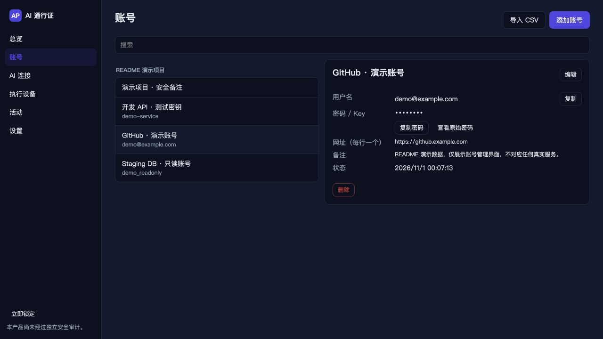

<!-- SPDX-License-Identifier: Apache-2.0 -->
# AI 通行证 桌面 App / AI Pass desktop

AI 通行证的开源桌面客户端，位于开源仓库的 `desktop/`（单仓库中为 `open-source/desktop/`），以 Apache-2.0 许可发布。
The open-source desktop client of AI Pass. It lives in `desktop/` of the open-source repository
(`open-source/desktop/` in the monorepo) and is licensed under the Apache License 2.0 (see `../LICENSE`).

一套代码同时面向 macOS、Windows、Linux（Tauri 2：Rust 核心 + React/TypeScript 界面）。
One cross-platform codebase (Tauri 2: Rust core + React/TypeScript UI) for macOS, Windows and Linux.

## 界面预览 / Screenshots

截图使用演示账号与资源，更多界面见[仓库 README](../README.md#桌面-app)。
Screenshots use demo accounts and resources. See the [repository README](../README.en.md#desktop-app) for more views.



## Purpose

The desktop app is the user's trusted client on a computer:

- **账号库 / Vault** — `aipass_sync::VaultClient` (create, unlock, items, generator, TOTP, CSV import, encrypted / CSV export, sync, conflicts, devices, recovery, storage test + migration).
- **本机执行设备 / Embedded local node** — `aipass-broker` + `aipass-executor` in-process (protection level **兼容连接 / compatible**). The broker API is served on `<AIPASS_HOME>/run/broker.sock` (0600, connection auth only, no admin peers) so `aipass-mcp` bridges started by AI hosts reach it with no extra config; the UI talks to the broker in-process.
- **AI 连接 / Host wizard** — `aipass-hostconfig` detect → per-host connection + key (`<AIPASS_HOME>/connections/conn_….key`, 0600) → secret-redacted diff preview → backup + atomic write → remove; pairing-code approvals for bridges paired with `aipass-mcp pair`; pause / resume / remove / revoke-all; remote-host instructions (honest about the official gateway not being end-to-end blind).
- **审批 / Approvals** (§5.3) — modal with the fixed field order, 允许本次 / 选择较小权限 / 拒绝 and 转到手机处理; the vault recomputes the digest, signs, and seals the bound credential (HPKE) to the embedded executor; the broker verifies everything again. Never auto-approves on timeout. The modal signs exactly the request it shows: `list_approvals` rows carry `request_digest` (`aipass_types::approval::request_digest`), `approve_request` / `deny_request` require it, and the Rust core refuses with `INTEGRITY_FAILED` if the broker's copy no longer hashes to it; the signed §7 digest is v2 (binds the waiting operation and its parameters digest). Every approval (and every bridge-connection approval) needs fresh presence: the unlock password is re-entered and verified in Rust for that one decision (`REAUTH_REQUIRED` without it; the reveal/export re-auth window does not count; 5 consecutive misses lock the app), so a desktop-driving agent cannot approve its own request with a click. 每次批准都需重新输入解锁密码。
- **绑定手机 / Pairing** (§9.5, CONTRACTS §5) — both directions: desktop as trusted device (paste the phone's `aipass://pair` link, compare SAS, confirm) and desktop as new device (onboarding "加入已有账号库" shows the QR, phone confirms).
- **活动 / Activity** — operations, approvals, grants with 3-level revocation reports, audit-chain verification.
- **云账户 / Cloud account** (optional, CONTRACTS §13) — sign-in, subscription, licence activation; licences verified offline (Ed25519 over JCS(payload)); licence failure never blocks unlock / export / recovery / revoke. Node link (`POST /v1/nodes/link`, signed `exe_…`) and the remote-MCP tunnel (`TunnelClient` + the `aipass-mcp` Streamable-HTTP handler bound to in-process broker handles).
- **手机审批 / Relay** — the embedded executor is enrolled as a vault member (role executor) via the real pairing protocol over an in-memory relay; with a relay URL configured the broker's `DeviceOutbox` posts sealed requests to approvers and a consumer long-polls the `exe_…` mailbox and feeds decisions back to the broker.
- **浏览器扩展 / Native messaging** (CONTRACTS §11) — IPC server on `<AIPASS_HOME>/run/desktop.sock` (Windows: named pipe) authenticated by the per-install token `<AIPASS_HOME>/run/desktop.token` (0600, CSPRNG), peer-uid check, extension-origin allow-list; plus the `aipass-nm-host` binary and the host-manifest installer for Chrome / Chromium / Edge / Brave.
- All eight exception pages of §11.5, zh-CN default + complete English.

## Architecture

```
desktop/                     (open-source/desktop/ in the monorepo)
├── src/                     React UI (metadata only)
│   ├── api.ts               typed invoke wrappers
│   ├── i18n.ts              zh-CN + en dictionaries (honesty rules)
│   ├── logic.ts             pure logic (approval rows, narrowing, grouping, exceptions) — unit-tested
│   └── screens/             Onboarding, Unlock, Overview, Accounts, Connections, Executors,
│                            Activity, Settings, PairPhone, ApprovalModal, Exceptions
├── scripts/build-sidecars.mjs   builds aipass-mcp + aipass-nm-host → src-tauri/binaries/<name>-<triple>
├── scripts/make-icon.py     original icon artwork (stdlib PNG writer)
└── src-tauri/               Cargo workspace (own Cargo.lock, excluded from ../Cargo.toml), depends on ../../crates/* by path
    ├── src/core.rs          AppCore: lifecycle, secret store, items, import/export, sync, devices, storage
    ├── src/core_ai.rs       node status, connections, host wizard, projects/resources, approvals, activity
    ├── src/core_pair.rs     pairing (both directions), QR SVG
    ├── src/node.rs          EmbeddedNode (broker + executor, UDS / Windows loopback TCP)
    ├── src/nm_server.rs     native-messaging handler + IPC server (token, uid, origin checks, rate limits)
    ├── src/nm_install.rs    host manifest installer (macOS / Linux files, Windows registry via reg.exe)
    ├── src/cloud.rs         cloud client + offline licence verification
    ├── src/relay.rs         DeviceOutbox over RelayClient + exe_ mailbox consumer
    ├── src/tunnel.rs        node link + remote-MCP tunnel handler
    ├── src/secrets.rs       LockableSecretStore (FileSecretStore: Argon2id + XChaCha20-Poly1305, 0600)
    ├── src/clipboard.rs     copy with auto-clear (only a SHA-256 of the value is kept), marked concealed / excluded from clipboard history + cloud sync
    ├── src/commands.rs      Tauri commands (input validation, native file dialogs)
    └── nm-host/             crate `aipass-nm-host` (lib `aipass_nm`: framing, IPC paths, handshake; bin)
```

**Secrets and the WebView.** The UI receives metadata only. Exceptions, by design: `reveal_secret`
(查看原始密码 — needs a re-authentication within the last 60 s; the UI hides it after 30 s) and the
one-time recovery key during onboarding / key replacement. Copy goes Rust → OS clipboard (cleared after
30 s if unchanged). Generated passwords stay in Rust behind single-use `gen_…` handles. CSV / `.aipassx`
files and the recovery kit are read and written in Rust through native dialogs. Passwords the user types
(unlock, item edit, export password) necessarily originate in the WebView and are sent into Rust only.
Tauri events carry no secrets; nothing secret is logged (`AIPASS_LOG` controls stderr tracing).

**WebView hardening.** Strict CSP (`default-src 'self'`, no inline script, no remote origins, `object-src
'none'`, `frame-ancestors 'none'`), `freezePrototype`, no global Tauri object, capabilities limited to
`core:event:allow-listen/unlisten`; no fs / shell / http / opener plugins. The dialog plugin is used only
from Rust.

**Unlock.** The device key (and storage / cloud session secrets) live in an encrypted file store opened
with the local unlock password (Argon2id m=64 MiB, t=3, p=1). This is identical on all three OSes.
OS keychain / Touch ID / Windows Hello integration is *not* claimed in this build.

**Embedded executor.** Protection level is always 兼容连接 / compatible: it shares the user session with the
AI tools and cannot resist same-user code, debugging or full takeover (§9.3) — the UI says so.

## Build / test / run

Prerequisites: Rust (edition 2024; tested with nightly-2026-04-29 / 1.97), Node 24 + pnpm. macOS: Xcode Command Line Tools.
Linux: `webkit2gtk-4.1`, `libsoup-3.0`, `libayatana-appindicator3` (Tauri 2 prerequisites).
Windows: WebView2 + MSVC build tools.

```sh
cd desktop                                         # open-source/desktop in the monorepo
pnpm install
pnpm typecheck && pnpm test && pnpm build          # UI: tsc, vitest, vite build → dist/

node scripts/build-sidecars.mjs                    # aipass-mcp + aipass-nm-host → src-tauri/binaries/
cd src-tauri
cargo test --workspace                             # Rust unit + integration tests
cd ..
```

Every `aipass-desktop` build copies the bundled sidecars (`src-tauri/binaries/<name>-<triple>`) over
`target/debug/aipass-nm-host` / `aipass-mcp` (Tauri `externalBin`). **After changing `nm-host/`, rerun
`pnpm sidecars`**, otherwise the IPC test and the app run the previous host. `tests/mcp_bridge.rs` uses
`../target/debug/aipass-mcp` of the open-source workspace (built on first use, or `AIPASS_MCP_PATH`) and a throw-away
PostgreSQL (Homebrew `initdb`/`pg_ctl`, port 55451 or the next free one, stopped and deleted at the end;
skipped without PostgreSQL unless `AIPASS_REQUIRE_PG=1`). The extension ↔ host conformance suite lives in the
browser extension (`clients/browser-extension`, `pnpm test:conformance`; the extension itself is not part of the
open-source repository) and drives the real host against
`examples/nm_test_core.rs`, a test-mode core with a throw-away vault and fake logins.

```sh
pnpm tauri dev                                     # run (UI dev server on 127.0.0.1:1420)
pnpm tauri build --debug --bundles app             # macOS .app bundle (debug)
```

Platform packages (run on the target platform):

```sh
pnpm tauri build --bundles msi,nsis                # on Windows
pnpm tauri build --bundles deb,appimage,rpm        # on Linux
```

Environment: `AIPASS_HOME` (default `~/.aipass`), `AIPASS_CLOUD_URL`, `AIPASS_LOG`, `AIPASS_MCP_PATH` /
`AIPASS_NM_HOST_PATH` (override the sidecar locations, e.g. for development).

### Tests

Run frontend checks with `pnpm typecheck && pnpm test && pnpm build`, and Rust tests with
`cargo test --workspace` from `src-tauri/`.

| Test | Coverage |
| --- | --- |
| `tests/desktop_core.rs` | Vault lifecycle, re-authentication, native messaging, IPC, approvals and revocation |
| `tests/relay_phone_approval.rs` | Encrypted relay messages, phone approval and executor enrollment |
| `tests/mcp_bridge.rs` | MCP pairing, PostgreSQL requests, approval and session revocation |
| `tests/phone_approval.rs` | Device pairing in both directions, phone approvals and device revocation |
| `tests/tunnel_handler.rs` | Remote connections, pending approvals and MCP tunnel handling |

### Windows / Linux notes

- **Windows**: the IPC endpoint is a named pipe `\\.\pipe\aipass-desktop-<hash of AIPASS_HOME>` created
  with `first_pipe_instance(true)` (remote clients rejected by default); the token file lives in
  `%USERPROFILE%\.aipass\run\desktop.token` (protected by the profile ACL, no POSIX modes). The broker is
  served on loopback TCP `127.0.0.1:7878` (aipass-mcp's Windows default). The native-messaging manifest is
  written to `%LOCALAPPDATA%\AIPass\com.aipass.native.json` and registered under
  `HKCU\Software\<Browser>\NativeMessagingHosts\com.aipass.native` via `reg.exe`. None of this was compiled
  or run here.
- **Linux**: manifests go to `~/.config/<browser>/NativeMessagingHosts/`. The secret store is the same
  encrypted file (no Secret Service dependency); Secret Service integration is a possible later option.
  Flatpak/Snap browsers need the host exposed to their sandbox (not handled).

## Limitations

- Recovery verification can race with background sync: an older sync snapshot can overwrite
  `recovery_verified_at`, causing the recovery reminder to reappear.
  恢复材料验证状态可能被并发的后台同步覆盖，界面会再次提示“恢复材料未验证”。
- Phone approvals need a relay URL in 设置 (official cloud relay or a self-hosted node) and a relay that
  accepts the executor's `exe_…` signature (the official / self-host relay resolves it from the vault
  member record the desktop writes when it enrols its executor). Tested against an in-process relay with a
  static directory only. "转到手机处理" defers the request on the desktop; it stays pending until handled
  or expired.
- Remote MCP (node link + tunnel) is implemented and the frame handler is tested, but the link and the
  WebSocket tunnel were not run against the real cloud. The gateway sees content (not end-to-end blind).
- Unix socket paths are limited to 104 bytes on macOS (108 on Linux): a very long `AIPASS_HOME` makes the
  IPC / broker sockets fail (logged; the rest of the app keeps working).
- The embedded executor is `compatible` only. No OS keychain / biometric unlock.
- The relay / cloud / S3 paths were not exercised against live services here (only local folder storage).
- Tauri commands are not covered by WebView-level E2E tests (no WebDriver for WKWebView on macOS); the
  logic behind every command is tested through `AppCore`.

## Contract deviations

- Tauri commands `approve_request {approval_request_id, request_digest, narrowed?, password}` and
  `deny_request {approval_request_id, request_digest}` require the displayed request's digest; rows of
  `list_approvals` add `request_digest` (CONTRACTS §7 / §16.9).

- Desktop data root = `AIPASS_HOME` (default `~/.aipass`) so `<data>/run/desktop.sock` and
  `<AIPASS_HOME>/run/broker.sock` are the same `run/` directory; the vault data dir is `<home>/vault`.
- IPC framing between `aipass-nm-host` and the app reuses Chrome framing (u32 LE + JSON) and starts with an
  auth frame `{"type":"auth","v":1,"token","origin"}` → `{"type":"auth","ok":true|false,"code"?}`. The token
  is 32 random bytes, hex-encoded (64 chars), in `<home>/run/desktop.token`.
- When the desktop app is not running, `aipass-nm-host` answers by itself: `hello` →
  `{app_version:<host version>, locked:true, ai_mode_available:false}` and `status` → `{locked:true}` (so the
  extension can finish its `hello` and offer 打开桌面 App), `open_app` tries to launch the app, and every other
  request (including `lock`, which the host cannot prove) gets `LOCKED`. A refused auth handshake gives
  `NOT_PAIRED`. Unknown request types and invalid inputs use `INVALID_REQUEST` (not in the §11 list; the
  extension shows a generic error).
- `match` / `fill` send `username: null` for entries without a username; `fill` of an unknown entry id is
  `NOT_FOUND`, of an existing entry for another site `ORIGIN_MISMATCH`; `save` answers
  `{status:"needs_confirmation", entry_id:null}` when several saved logins match.
- Broker approvers follow the vault: the desktop itself, devices it pairs as owner/member, and — when the
  desktop joins an existing vault — the trusted devices listed in the verified `pairing.welcome`. After every
  sync, approvers whose member record is revoked (or no longer owner/member) are revoked in the broker.
  Devices paired later on *another* trusted device are not added automatically (the open-source vault API
  exposes their keys only through pairing); pair them with the desktop, or they approve on their own node.
- Windows broker endpoint is loopback TCP `127.0.0.1:7878` (no UDS on Windows in this build).
- Licence tokens are verified over the decoded JCS payload bytes and must be canonical; the cloud public key
  is pinned on first activation (no key is embedded yet because the cloud signing key is not fixed).
- The desktop enrols its embedded executor as a vault member (`dev_<U>` ⇔ `exe_<U>`, role executor, no VMK)
  by running the §5 pairing protocol in-process over a memory relay, so other trusted devices can seal
  credentials to it and relays / sync servers accept its signature. The member is shown as "本机执行设备".
- Node link uses `node_id = exe_…` (the embedded executor id) and `protection_level: "compatible"`.
- Org policy frames (`policy.org`) are logged but not enforced on a personal desktop node.

**屏幕捕获 / Screen capture.** 主窗口设置了 `contentProtected`（macOS `NSWindowSharingNone`，Windows
`WDA_EXCLUDEFROMCAPTURE`），截图、录屏、屏幕共享和截屏型 Agent 看不到窗口内容（包括显示的密码、验证码和恢复密钥）。
Linux 没有可靠的同等机制：在 Linux 上请不要在 AI Agent 能截屏的桌面上查看密码。
The main window is content-protected, so screenshots, screen recording/sharing and screenshot-taking agents do
not capture it (revealed secrets, TOTP codes, recovery key). Linux has no reliable equivalent; do not reveal
secrets on a Linux desktop an agent can capture.

## License

Apache License 2.0 — the same licence as the rest of the open-source repository (`../LICENSE`, `../NOTICE`).
本目录以 Apache-2.0 许可开源。手机 App、浏览器扩展、官方云服务、团队功能和官方维护的集成不在开源范围内。
The mobile apps, browser extension, official cloud services, team features and maintained integrations are not
part of the open-source release.
